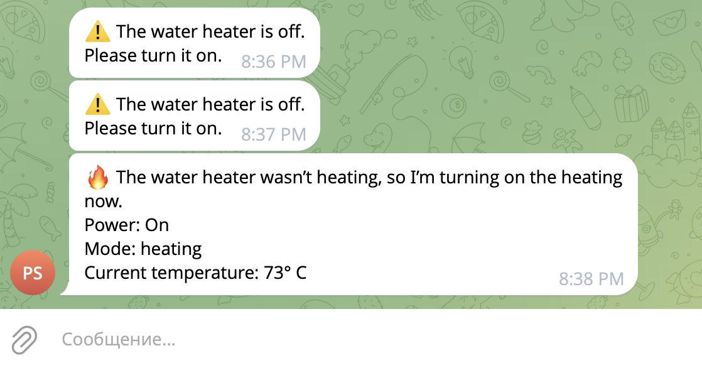

# BoilerOn


I have a smart boiler at home and sometimes someone touches the boiler switch, there is no water next to the light switch and then when it is necessary to wash. I thought it was really annoying if you want to wash but there's no water, so I created BoilerOn, a simple solution in a single python file. The main task is to write turn on the boiler if someone accidentally unplugged the boiler.


## Features
- Boiler status monitoring
- Notification if the boiler is not available
- If the boiler is online (turned on by the switch), but not turned on to heat the water, then this script will turn on to heat the water.

## Setup
1. Rename `.env.example` to `.env`.
2. Register platform.tuya.com
3. Select your region, get all the data (it's been a long time since I remember how I did it, it's really difficult and honestly there's an incomprehensible interface)
4. Install the dependencies
5. Copy boileron.service to systemd

```bash
pip install -r requirements.txt
```

Check the service file where the paths should go to your main.py and replace the username with yours (if not root):

```bash
nano boileron.service
```


Copy template systemd to /etc/systemd/system/:
```bash
sudo cp boileron.service /etc/systemd/system/
```

Reload systemd:
```bash
sudo systemctl daemon-reload
```


This app runs in a loop and checks the boiler every 5 seconds.

In general, there are plans to rewrite this program in C, then it will work faster.